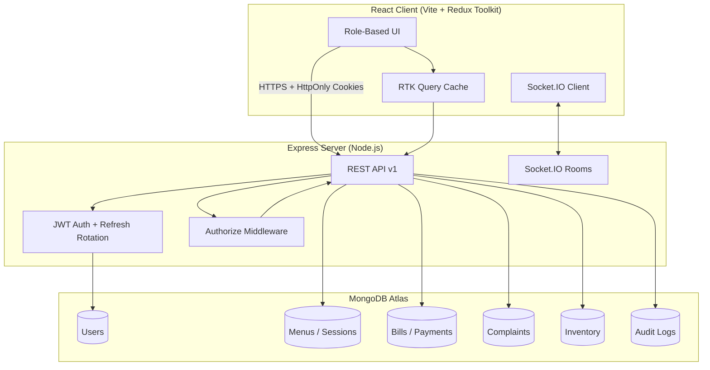
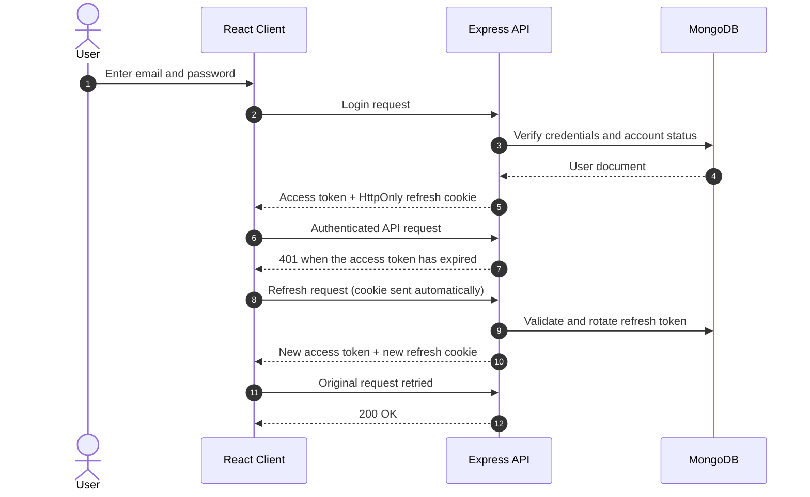
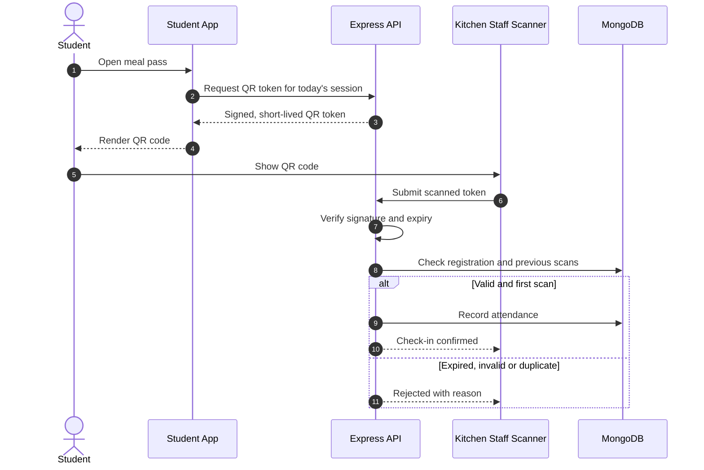
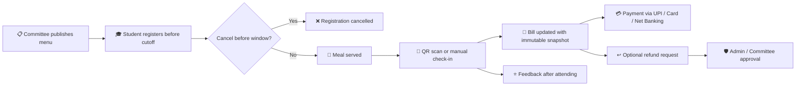
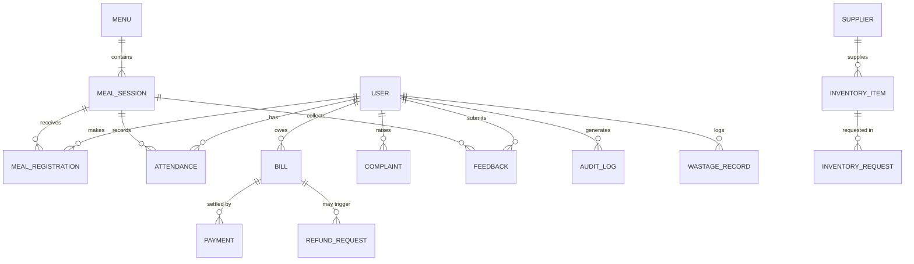
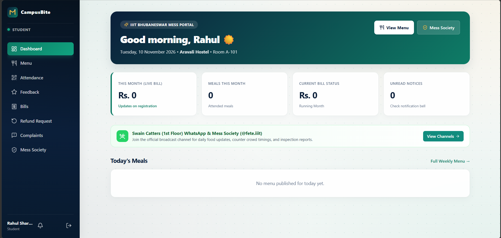
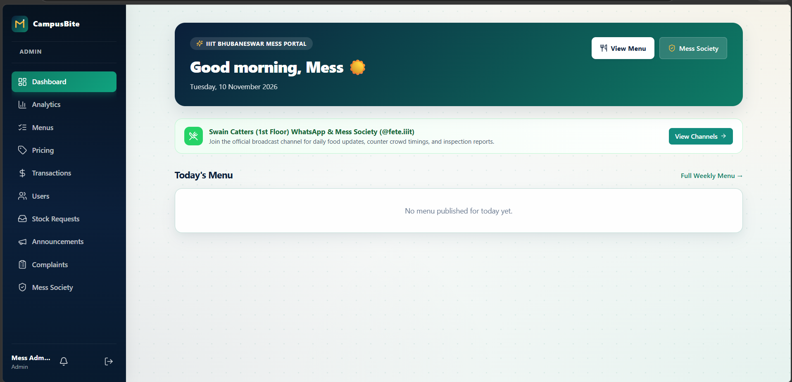

# 🍽️ CampusBite — Smarter Meals. Better Campus Living.

> **A full-stack MERN campus mess management ecosystem built for IIIT Bhubaneswar.**  
> Students, Mess Committees, Admins, and Kitchen Staff — all connected through one real-time, role-based platform backed by MongoDB.

[](https://campusbite-5pfk.onrender.com/)
[](https://nodejs.org/)
[](https://react.dev/)
[](https://www.mongodb.com/atlas)
[](https://expressjs.com/)
[](https://redux-toolkit.js.org/)

---

## 📑 Table of Contents
- [About the Project](#-about-the-project)
- [Live Demo](#-live-demo)
- [Core Features](#-core-features)
- [Dual Mess System](#-dual-mess-system)
- [Tech Stack](#-tech-stack)
- [System Architecture](#-system-architecture)
- [Sneak Peek (UI/UX)](#-sneak-peek-uiux)
- [Quick Start & Local Development](#️-quick-start--local-development)
- [Environment Variables](#-environment-variables)
- [Project Structure](#-project-structure)
- [Support & Administration](#-support--administration)

---

## 📝 Project Submission Details

<div align="center">

### 🎓 Project Report · Campus Mess Management System

*Respectfully submitted to **Prof. Bharati Mishra** for evaluation* 🙏

</div>

| 📌 Field | 📄 Details |
|---|---|
| 🏷️ **Project Title** | CampusBite — Smarter Meals. Better Campus Living. |
| 👩‍🏫 **Submitted To** | **Prof. Bharati Mishra** |
| 👨‍🎓 **Submitted By** | **Subhro Mitra** |
| 🆔 **Roll Number** | `B423066` |
| 🏫 **Institute** | International Institute of Information Technology (IIIT), Bhubaneswar |
| 🏛️ **Programme** | B.Tech (Final Year) — `Information technology` |
| 📚 **Course / Subject** | `Internet and Web Technology (IWT)` |
| 📅 **Academic Session** | `2026-2027` |
| 🗓️ **Date of Submission** | `10'th November 2026 ` |
| 🧩 **Project Type** | Full-stack web application (MERN) with real-time features |
| 🌐 **Live Application** | [campusbite-5pfk.onrender.com](https://campusbite-5pfk.onrender.com/) |
| 💻 **Source Code** | [github.com/subhromitra2004/CampusBite](https://github.com/subhromitra2004/CampusBite) |

[](https://campusbite-5pfk.onrender.com/)
[](https://github.com/subhromitra2004/CampusBite)
[](#-more-in-this-readme)

> [!NOTE]
> This README doubles as the project report. The report-style sections (Problem Statement, Objectives, Scope, Requirements, Test Cases, Outcomes and Conclusion) are listed in [More in This README](#-more-in-this-readme).

---

## 🎯 About the Project

**CampusBite** replaces the traditional paper-and-queue mess system with a **real-time, role-aware web application**. Every meal registration, QR scan, payment, complaint, inventory movement, and feedback rating is persisted in MongoDB and authorized server-side.

> *"Every button triggers a real API call backed by MongoDB. No mock data, no fake state."*

Built as a production-oriented MERN challenge, the project demonstrates:

- **Advanced RBAC** with four distinct roles and fine-grained route guards.
- **Refresh-token rotation** with HttpOnly secure cookies — no JWT in `localStorage`.
- **QR-based meal check-in** with signed, short-lived tokens and duplicate-scan prevention.
- **Dual mess systems**: pay-per-meal (1st Floor) and one-time semester fee (Ground Floor).
- **Admin-only pricing control** for per-meal rates and semester fees.
- **Socket.IO** live notifications for announcements, complaints, and kitchen alerts.

---

## 🚀 Live Demo

| | |
|---|---|
| **Frontend + Backend** | [https://github.com/subhromitra2004/CampusBite](https://campusbite-5pfk.onrender.com/) |
| **Repository** | [https://github.com/subhromitra2004/CampusBite](https://github.com/subhromitra2004/CampusBite) |

### Demo Credentials

| Role | Email | Password |
|---|---|---|
| **Admin (Super)** | `admin@gmail.com` | `admin@123` |
| **Mess Secretary** | `mess.secretary@gmail.com` | `secretary@123` |
| **Kitchen Staff** | `staff@gmail.com` | `staff@123` |
| **Student (1st Floor)** | `rahul.sharma@iiit-bh.ac.in` | `Student@123` |

> **Note:** The Render free tier sleeps after inactivity. The first request may take 30–50 seconds to cold-start.

---

## ✨ Core Features

### 🎓 For Students
- **Dynamic menu browsing** — view today, tomorrow, and upcoming menus with dietary labels, allergens, and special-meal flags.
- **Meal registration** — register before configurable cutoff windows; cancel anytime before the cancellation window.
- **QR meal pass** — signed, short-lived QR token for contactless check-in.
- **Attendance history** — monthly meal count, streak, and full timeline.
- **Live billing** — itemized running bill with immutable snapshots; pay via UPI, Card, or Net Banking (mock provider).
- **Refund requests** — request meal refunds with admin approval workflow.
- **Complaints** — categorized grievances with image uploads, priorities, and full resolution timeline.
- **Feedback** — rate taste, quality, hygiene, quantity, and overall satisfaction after attending a meal.
- **Guest meal booking** — reserve meals for guests with automatic billing sync.

### 🍳 For Kitchen Staff
- **Menu & prep view** — read-only view of today’s and tomorrow’s meal items.
- **QR attendance** — scan student meal passes; manual fallback by student ID.
- **Wastage recording** — log leftover, spoiled, or overcooked items with cost estimates.
- **Inventory requests** — request stock from the admin; track approval status.
- **Leave management** — submit leave requests for kitchen duty.

### 📋 For Mess Committee
- **Menu CRUD** — create, edit, and publish daily menus with auto-created meal sessions.
- **Billing & payments** — view all student payments, approve refunds, manage adjustments.
- **Complaint resolution** — assign, update status, and respond to student grievances.
- **Inventory & suppliers** — manage stock, purchase orders, and low-stock alerts.
- **Announcements** — publish notices to targeted roles with real-time delivery.

### 🛡️ For Admin (Super)
- **Institutional analytics** — attendance, feedback trends, wastage, and financial performance.
- **User management** — approve, suspend, or reactivate any account (warden protected).
- **Pricing control** — set per-meal prices and Ground Floor semester fee; **exclusive to Admin**.
- **Policy configuration** — registration cutoffs, cancellation windows, leave policies.
- **Audit logs** — full history of sensitive actions.
- **Role management** — configure permissions and manage Mess Committee accounts.

---

## 🏢 Dual Mess System

CampusBite supports **two parallel mess systems** running on the same menu:

| Feature | 1st Floor Mess (Swain Catters) | Ground Floor Mess (IRCTC) |
|---|---|---|
| **Payment model** | Pay per meal | One-time semester fee (₹17,000 security deposit) |
| **Registration** | Daily, before cutoff | Enrolled once via .docx forms |
| **Meal selection** | Any meal, any day | **Minimum 3 out of 4 meals** (breakfast/lunch/snacks/dinner) |
| **Attendance** | QR or manual check-in | Staff marks present from the semester roster |
| **Billing** | Monthly running bill | Prepaid; no per-meal billing |
| **Pass** | QR meal pass per session | Printable **Semester Pass** with payment reference |

> Students choose their mess system after first login. The choice can be reset by an Admin if required.

---

## 🛠️ Tech Stack

### Backend
- **Node.js 20+** & **Express.js** (ES Modules)
- **MongoDB** & **Mongoose 8** (Atlas-ready, indexed schemas)
- **JWT authentication** with **refresh-token rotation** and **HttpOnly cookies**
- **Zod** for request validation
- **Helmet**, **CORS**, **express-rate-limit**, **compression**
- **Socket.IO** for real-time notifications
- **Pino** for structured logging
- **Cloudinary** (optional) for image uploads
- **Multer** for file handling

### Frontend
- **React 18** + **Vite 6**
- **Redux Toolkit** & **RTK Query** for server-state management
- **React Router 6** with protected routes and role guards
- **Recharts** for analytics (where applicable)
- **Lucide React** for icons
- **Sonner** for toast notifications
- **QRCode.react** for QR generation
- **html5-qrcode** for scanning

### DevOps
- **Render** (Web Service + MongoDB Atlas)
- **GitHub** for version control

---

## 🧰 Tech Stack at a Glance

**🟢 Backend**


**⚛️ Frontend**


**🗄️ Database & Hosting**


**🛠️ Tooling**


---

## 🏗️ System Architecture



<details>
<summary>🖨️ <b>Text version of the architecture diagram</b> (for viewers that cannot render Mermaid)</summary>

```text
┌──────────────────────────────────────────────────────────────────┐
│  REACT CLIENT  (Vite + Redux Toolkit)                            │
│                                                                  │
│  [ Role-Based UI ] ──► [ RTK Query Cache ] [ Socket.IO Client ]  │
└──────────────────────────────────────────────────────────────────┘
         │  HTTPS + HttpOnly Cookies                │  WebSocket
         ▼                                          ▼
┌──────────────────────────────────────────────────────────────────┐
│  EXPRESS SERVER  (Node.js)                                       │
│                                                                  │
│  [ JWT Auth + Refresh Rotation ] ──► [ Authorize Middleware ]    │
│        │                                                         │
│        ▼                                                         │
│  [ REST API v1 ]                           [ Socket.IO Rooms ]   │
└──────────────────────────────────────────────────────────────────┘
        │
        ▼
┌──────────────────────────────────────────────────────────────────┐
│  MONGODB ATLAS                                                   │
│                                                                  │
│   ( Users )   ( Menus / Sessions )   ( Bills / Payments )        │
│   ( Complaints )   ( Inventory )   ( Audit Logs )                │
└──────────────────────────────────────────────────────────────────┘
```

</details>

### 🧱 Architecture Layers

| 🧱 Layer | 🎯 Responsibility | 🧰 Key Technologies |
|---|---|---|
| 🖼️ **Presentation** | Role-based screens, route guards, forms, charts | React 18, React Router 6, Recharts, Lucide React |
| 🔄 **State & Data Fetching** | Server-state caching, cache invalidation, loading and error states | Redux Toolkit, RTK Query |
| 🔌 **API** | Versioned REST endpoints, request validation, error handling | Express.js, Zod |
| 🛡️ **Security** | Authentication, authorization, rate limiting, secure headers | JWT, HttpOnly cookies, Helmet, CORS, express-rate-limit |
| ⚡ **Real-time** | Live announcements, complaint updates, kitchen alerts | Socket.IO rooms |
| 🗄️ **Persistence** | Indexed document schemas, immutable bill snapshots, audit trail | MongoDB Atlas, Mongoose 8 |
| 📷 **Media** | Complaint image uploads | Multer, Cloudinary (optional) |
| 📈 **Observability** | Structured, machine-readable logs | Pino |

### 🔑 Authentication Flow

Sessions use short-lived access tokens and **rotating refresh tokens** delivered through HttpOnly cookies, so no token is ever readable by JavaScript or stored in `localStorage`.



### 📲 QR Meal Check-in Flow



### 🔁 Meal Lifecycle



### 🗃️ Conceptual Data Model

A simplified view of how the main collections relate to each other.



<p align="right"><a href="#readme">⬆ Back to top</a></p>

---

## 📸 Sneak Peek (UI/UX)

CampusBite is designed so that every role lands on a dashboard built around the tasks they perform most often, with no clutter from features they cannot use.

### 🎨 Design Principles

| 🎨 Principle | 💡 How it shows up in the product |
|---|---|
| 🧭 **Role-first navigation** | Each role sees only its own menu, routes and actions; guards are enforced both in the UI and on the server |
| 📱 **Mobile-friendly** | Students check menus and show QR passes on their phones, so core flows work on small screens |
| 🔔 **Instant feedback** | Toast notifications (Sonner) confirm every action; RTK Query keeps screens in sync without manual refreshes |
| ⚡ **Live by default** | Announcements, complaint updates and kitchen alerts arrive in real time through Socket.IO |
| 🏷️ **Clear status language** | Registrations, payments, refunds and complaints all show an explicit, color-coded status |
| 📊 **Data at a glance** | Charts and summaries on admin dashboards turn raw records into decisions |

### 🖥️ Screens by Role

| Role | Key Screens | What You Can Do There |
|---|---|---|
| 🎓 **Student** | Dashboard, Menu, My Meals, QR Pass, Billing, Complaints, Feedback | See what's cooking, register or cancel, show your pass, pay your bill, raise issues |
| 🍳 **Kitchen Staff** | Prep View, QR Scanner, Wastage Log, Inventory Requests, Leave | Check tomorrow's counts, scan passes, log wastage, request stock |
| 📋 **Mess Committee** | Menu Manager, Payments, Complaints Desk, Inventory, Announcements | Publish menus, track payments, resolve grievances, broadcast notices |
| 🛡️ **Admin** | Analytics, Users, Pricing, Policies, Audit Logs, Roles | Monitor performance, control prices and policies, review sensitive actions |

### 🖼️ Screenshot Gallery

<table>
  <tr>
    <td align="center" width="50%">
      
      <br/><b>🎓 Screenshot 1 — Student Dashboard</b>
      <br/><sub>Menus, meal registration, QR pass and live billing in one place</sub>
    </td>
    <td align="center" width="50%">
      
      <br/><b>🛡️ Screenshot 2 — Admin Dashboard</b>
      <br/><sub>Analytics, pricing, policies and audit logs</sub>
    </td>
  </tr>
</table>

> [!TIP]
> Images are loaded from `docs/screenshots/` in this repository. Want to show more? Uncomment the extended gallery below and add the matching image files.

<!--
<table>
  <tr>
    <td align="center"><br/><sub><b>Student Dashboard</b></sub></td>
    <td align="center"><br/><sub><b>QR Meal Pass</b></sub></td>
  </tr>
  <tr>
    <td align="center"><br/><sub><b>Menu Manager</b></sub></td>
    <td align="center"><br/><sub><b>Admin Analytics</b></sub></td>
  </tr>
  <tr>
    <td align="center"><br/><sub><b>Kitchen QR Scanner</b></sub></td>
    <td align="center"><br/><sub><b>Complaints Desk</b></sub></td>
  </tr>
</table>
-->

<p align="right"><a href="#readme">⬆ Back to top</a></p>

---

## ⚙️ Quick Start & Local Development

### ✅ Prerequisites

| 🧰 Tool | 🔢 Version | 📝 Notes |
|---|---|---|
| 🟢 **Node.js** | 20 or newer | Check with `node -v` |
| 📦 **npm** | 10 or newer | Ships with Node.js 20 |
| 🍃 **MongoDB** | Atlas cluster or local 6+ | A free Atlas M0 cluster is enough |
| 🔧 **Git** | Any recent version | For cloning the repository |

### 🚦 Setup in 5 Steps

**1. Clone the repository**

```bash
git clone https://github.com/subhromitra2004/CampusBite.git
cd CampusBite
```

**2. Install dependencies**

```bash
# Backend
cd server
npm install

# Frontend
cd ../client
npm install
```

**3. Configure environment variables**

Create a `.env` file in both `server/` and `client/`. See [Environment Variables](#-environment-variables) for every key.

**4. (Optional) Seed the database with demo data**

```bash
cd server
npm run seed
```

**5. Start the development servers**

```bash
# Terminal 1 — API (http://localhost:5000)
cd server
npm run dev

# Terminal 2 — React app (http://localhost:5173)
cd client
npm run dev
```

Open **http://localhost:5173** and sign in with one of the [demo credentials](#demo-credentials).

### 📜 Common Scripts

| Command | Where | What it does |
|---|---|---|
| `npm run dev` | `server/` | Starts the API with auto-reload |
| `npm start` | `server/` | Starts the API in production mode |
| `npm run seed` | `server/` | Populates the database with demo users and menus |
| `npm run dev` | `client/` | Starts the Vite dev server with hot module replacement |
| `npm run build` | `client/` | Creates an optimized production bundle |
| `npm run preview` | `client/` | Serves the production bundle locally |

> [!NOTE]
> Script names above follow common MERN conventions. Check the `scripts` section of each `package.json` if one differs in your setup.

<p align="right"><a href="#readme">⬆ Back to top</a></p>

---

## 🔐 Environment Variables

### Backend (`server/.env`)

| Variable | Required | Example | Description |
|---|:---:|---|---|
| `NODE_ENV` | ✅ | `development` | Runtime mode; use `production` when deployed |
| `PORT` | ✅ | `5000` | Port the Express server listens on |
| `MONGODB_URI` | ✅ | `mongodb+srv://<user>:<pass>@<cluster>.mongodb.net/campusbite` | MongoDB connection string |
| `CLIENT_URL` | ✅ | `http://localhost:5173` | Allowed CORS origin and Socket.IO origin |
| `JWT_ACCESS_SECRET` | ✅ | *long random string* | Signs short-lived access tokens |
| `JWT_REFRESH_SECRET` | ✅ | *long random string* | Signs rotating refresh tokens |
| `JWT_ACCESS_EXPIRES_IN` | ➖ | `15m` | Access token lifetime |
| `JWT_REFRESH_EXPIRES_IN` | ➖ | `7d` | Refresh token lifetime |
| `QR_TOKEN_SECRET` | ✅ | *long random string* | Signs short-lived QR meal-pass tokens |
| `CLOUDINARY_CLOUD_NAME` | ➖ | `my-cloud` | Optional: complaint image uploads |
| `CLOUDINARY_API_KEY` | ➖ | `123456789012345` | Optional: Cloudinary API key |
| `CLOUDINARY_API_SECRET` | ➖ | *secret* | Optional: Cloudinary API secret |

### Frontend (`client/.env`)

| Variable | Required | Example | Description |
|---|:---:|---|---|
| `VITE_API_URL` | ✅ | `http://localhost:5000/api/v1` | Base URL for all API requests |
| `VITE_SOCKET_URL` | ➖ | `http://localhost:5000` | Socket.IO server URL |

> [!TIP]
> Generate strong secrets with:
> ```bash
> node -e "console.log(require('crypto').randomBytes(64).toString('hex'))"
> ```

> [!WARNING]
> Never commit `.env` files. Keep them listed in `.gitignore` and use your hosting provider's secret manager in production.

<p align="right"><a href="#readme">⬆ Back to top</a></p>

---

## 📂 Project Structure

```text
CampusBite/
├── client/                     # React 18 + Vite frontend
│   ├── public/
│   └── src/
│       ├── app/                # Redux store and RTK Query base API
│       ├── components/         # Reusable UI building blocks
│       ├── features/           # Feature slices (auth, menu, billing, complaints...)
│       ├── layouts/            # Role-based page shells
│       ├── pages/              # Screens grouped by role
│       ├── routes/             # Protected routes and role guards
│       ├── hooks/              # Custom React hooks
│       └── utils/              # Formatters and helpers
│
├── server/                     # Express + MongoDB backend
│   └── src/
│       ├── config/             # Database, CORS, logger and env setup
│       ├── controllers/        # Request handlers
│       ├── middleware/         # Auth, authorize, validate, rate limit, errors
│       ├── models/             # Mongoose schemas and indexes
│       ├── routes/             # REST API v1 route definitions
│       ├── services/           # Business logic (billing, QR, policies)
│       ├── sockets/            # Socket.IO rooms and events
│       ├── validators/         # Zod request schemas
│       ├── utils/              # Shared helpers
│       └── server.js           # Application entry point
│
├── docs/
│   └── screenshots/            # Images used in this README
├── .gitignore
└── README.md
```

> [!NOTE]
> This tree is a guide to how the codebase is organized. Folder names may differ slightly from the actual repository.

### 🧭 Where to Look

| I want to... | Start here |
|---|---|
| Add a new API endpoint | `server/src/routes/` and `server/src/controllers/` |
| Change who can access something | `server/src/middleware/` (authorize) and `client/src/routes/` |
| Add or change a database field | `server/src/models/` and the matching Zod schema in `validators/` |
| Add a new page for a role | `client/src/pages/` and register it in `client/src/routes/` |
| Push a real-time event | `server/src/sockets/` |

<p align="right"><a href="#readme">⬆ Back to top</a></p>

---

## 🆘 Support & Administration

### 💬 Getting Help

| Need | Where to go |
|---|---|
| 🐞 Found a bug | [Open an issue](https://github.com/subhromitra2004/CampusBite/issues) with steps to reproduce, expected result and a screenshot |
| 💡 Have a feature idea | [Open an issue](https://github.com/subhromitra2004/CampusBite/issues) and describe the problem it solves |
| ❓ Not sure how something works | Check the [FAQ](#-faq) and [Troubleshooting](#-troubleshooting) sections below |
| 🔐 Found a security issue | Please report it privately to the maintainer instead of opening a public issue |

### 🧑‍💼 Administrative Tasks

Some actions are deliberately restricted so that sensitive changes always pass through the right role.

| 📌 Task | 👤 Who can do it | 📝 Notes |
|---|---|---|
| 💲 Change per-meal prices or semester fee | **Admin only** | Pricing control is not available to the Mess Committee |
| 🔁 Reset a student's mess-system choice | **Admin** | Students pick once after first login |
| 👥 Approve, suspend or reactivate accounts | **Admin** | Warden accounts are protected |
| ⚙️ Configure cutoffs, cancellation windows and leave policy | **Admin** | Changes apply to future registrations |
| 🔍 Review sensitive actions | **Admin** | Available through audit logs |
| 📢 Publish announcements | **Mess Committee** | Delivered live to the selected roles |
| 🛠️ Resolve complaints and approve refunds | **Mess Committee** | Every update is added to the complaint timeline |

<p align="right"><a href="#readme">⬆ Back to top</a></p>

---

## 📚 More in This README

| Section | What's inside |
|---|---|
| [📝 Project Submission Details](#-project-submission-details) | Submission information for Prof. Bharati Mishra |
| [🧰 Tech Stack at a Glance](#-tech-stack-at-a-glance) | The stack in icon form |
| [💡 Problem & Solution](#-problem--solution) | Why CampusBite exists |
| [🧩 Problem Statement](#-problem-statement) | The problem in report form |
| [🏆 Objectives](#-objectives) | What the project set out to achieve |
| [🔍 Scope & Limitations](#-scope--limitations) | What is covered and what is not |
| [🔄 Development Approach](#-development-approach) | Phases from analysis to deployment |
| [📋 Requirements Specification](#-requirements-specification) | Functional and non-functional requirements |
| [💻 System Requirements](#-system-requirements) | What users, developers and hosting need |
| [📊 Project at a Glance](#-project-at-a-glance) | Key numbers and project badges |
| [🧭 Responsibility Map](#-responsibility-map) | Who does what across the four roles |
| [🧠 Design Decisions](#-design-decisions) | Why the stack and patterns were chosen |
| [🔒 Security Highlights](#-security-highlights) | Protections built into the platform |
| [⚡ Performance & Reliability](#-performance--reliability) | How the app stays fast and dependable |
| [🔌 API Overview](#-api-overview) | Resource groups exposed by the REST API |
| [🚢 Deployment Guide](#-deployment-guide) | Shipping to Render and MongoDB Atlas |
| [🧪 Smoke Test Checklist](#-smoke-test-checklist) | A quick manual test for every role |
| [🧾 Sample Test Cases](#-sample-test-cases) | Detailed scenarios with expected results |
| [🔭 Future Scope](#-future-scope) | What could come next |
| [🎓 Outcomes & Learnings](#-outcomes--learnings) | Skills and lessons from the build |
| [🏁 Conclusion](#-conclusion) | Summary of the project |
| [❓ FAQ](#-faq) | Short answers to common questions |
| [🐞 Troubleshooting](#-troubleshooting) | Fixes for common issues |
| [🤝 Contributing](#-contributing) | How to propose changes |
| [📜 License](#-license) | Usage terms |
| [🙏 Acknowledgements](#-acknowledgements) | Credits |
| [🌟 Special Thanks & Credits](#-special-thanks--credits) | Prof. Bharati Mishra, Claude, Gemini and Antigravity |
| [📚 References](#-references) | Documentation and sources |
| [👤 Author](#-author) | Who built it |

---

## 💡 Problem & Solution

| 😩 Traditional Mess Pain Point | ✅ How CampusBite Solves It |
|---|---|
| 📄 Paper registers and manual headcounts lead to over- or under-cooking | Digital meal registration with cutoff windows gives the kitchen a reliable count before cooking starts |
| ⏳ Long queues and proxy attendance | Signed, short-lived QR passes with duplicate-scan prevention |
| 🧾 Billing disputes at the end of the month | Itemized running bill backed by immutable snapshots |
| 📣 Complaints lost in word-of-mouth | Categorized complaints with priorities, image evidence and a full resolution timeline |
| 📦 Stock-outs and untracked wastage | Inventory requests, supplier and purchase-order management, and wastage logs with cost estimates |
| 📌 Notices pinned on boards that nobody reads | Role-targeted announcements delivered in real time |
| 🔍 Unclear who changed what | Audit logs and admin-only control over pricing and policy |
| 🏢 Two mess operators with different payment models | One platform that supports both pay-per-meal and semester-fee systems |

---

## 🧩 Problem Statement

Campus messes still depend on paper registers, manual headcounts, queues at the counter and month-end billing disputes. Students cannot see or plan meals reliably, the kitchen cannot predict how many people to cook for, the mess committee struggles to track payments, complaints and stock, and administrators have no consolidated view of attendance, wastage and finances. At IIIT Bhubaneswar the situation is harder still because **two mess operators with different payment models** run side by side.

**CampusBite** addresses this by moving every mess workflow onto one secure, real-time, role-based platform.

---

## 🏆 Objectives

1. 🔐 **Secure access** — give Students, Kitchen Staff, Mess Committee and Admin exactly the access their role needs, enforced on the server.
2. 🍽️ **Digitize meals** — publish menus, register and cancel meals within configurable windows, and give the kitchen reliable counts.
3. 📲 **Contactless check-in** — replace manual attendance with signed, short-lived QR passes that block duplicate scans.
4. 🧾 **Transparent billing** — maintain itemized running bills with immutable snapshots, online payments and a refund workflow.
5. 🏢 **Support both mess systems** — handle pay-per-meal and one-time semester-fee models on a single menu.
6. 📣 **Close the feedback loop** — capture complaints and meal ratings and track them through to resolution.
7. 📦 **Control operations** — manage inventory, suppliers, wastage and leave with clear approval flows.
8. 📊 **Enable decisions** — give administrators analytics, pricing control, policy configuration and audit logs.
9. ⚡ **Keep everyone informed** — deliver announcements and alerts in real time.

---

## 🔍 Scope & Limitations

### ✅ In Scope

- 🍽️ Daily menus, dietary labels, allergens and special-meal flags
- 📝 Meal registration, cancellation windows and guest meal booking
- 📲 QR meal passes, kitchen scanning and manual check-in fallback
- 💳 Running bills, mock payments (UPI, Card, Net Banking) and refunds
- 📣 Complaints with images, priorities and resolution timelines
- ⭐ Feedback on taste, quality, hygiene, quantity and overall satisfaction
- 📦 Inventory, suppliers, purchase orders, wastage and kitchen leave
- 📢 Targeted announcements with real-time delivery
- 📊 Analytics, user management, pricing, policy configuration and audit logs

### 🚧 Limitations

- 💳 Payments run through a **mock provider**, so no real money is moved.
- ☁️ The live demo is hosted on a free tier and can take 30–50 seconds to wake up after inactivity.
- 🏢 Ground Floor enrolment relies on `.docx` forms and a staff-maintained semester roster.
- 🏫 The configuration reflects the two mess operators at IIIT Bhubaneswar.
- 🔑 The published demo credentials are for evaluation only.

---

## 🔄 Development Approach

| Phase | Activities | Outcome |
|---|---|---|
| 🔎 **1. Requirement Analysis** | Study the two mess systems and the needs of Students, Kitchen Staff, Mess Committee and Admin | Role list, feature list and pricing rules |
| 🧱 **2. System Design** | Define architecture, RBAC model, data model, authentication and QR flows | Diagrams in [System Architecture](#-system-architecture) |
| 💻 **3. Implementation** | Build the Express API with Zod validation and Mongoose schemas, the React UI with RTK Query, and Socket.IO events | Working full-stack application |
| 🧪 **4. Testing** | Run role-wise smoke tests and edge cases such as duplicate scans, cutoffs and permission checks | [Test checklist](#-smoke-test-checklist) and [test cases](#-sample-test-cases) |
| 🚀 **5. Deployment** | Host on Render with MongoDB Atlas and environment-based configuration | [Live application](https://campusbite-5pfk.onrender.com/) |
| 🔁 **6. Iteration** | Refine flows and fix issues based on feedback | Continuous improvement |

---

## 📋 Requirements Specification

### ⚙️ Functional Requirements

| ID | Requirement | Primary Role(s) |
|---|---|---|
| **FR-01** | Authenticate users and enforce four roles with server-side authorization | 👥 All |
| **FR-02** | Let students choose a mess system after first login; allow Admin to reset the choice | 🎓 Student · 🛡️ Admin |
| **FR-03** | Publish daily menus with dietary labels, allergens and special-meal flags; auto-create meal sessions | 📋 Mess Committee |
| **FR-04** | Allow meal registration and cancellation within configurable cutoff and cancellation windows | 🎓 Student |
| **FR-05** | Issue signed, short-lived QR passes and verify scans, rejecting duplicates | 🎓 Student · 🍳 Kitchen Staff |
| **FR-06** | Record attendance, with manual fallback by student ID and roster-based marking for Ground Floor | 🍳 Kitchen Staff |
| **FR-07** | Generate itemized running bills with immutable snapshots, accept payments and process refund requests | 🎓 Student · 📋 Mess Committee |
| **FR-08** | Accept categorized complaints with images and priorities; track the resolution timeline | 🎓 Student · 📋 Mess Committee |
| **FR-09** | Collect post-meal feedback on taste, quality, hygiene, quantity and overall satisfaction | 🎓 Student |
| **FR-10** | Manage inventory, suppliers, purchase orders, stock requests and wastage records | 🍳 Kitchen Staff · 📋 Mess Committee · 🛡️ Admin |
| **FR-11** | Publish targeted announcements and deliver real-time notifications | 📋 Mess Committee |
| **FR-12** | Provide analytics, user management, pricing, policy configuration and audit logs | 🛡️ Admin |

### 🛡️ Non-Functional Requirements

| Category | Requirement |
|---|---|
| 🔐 **Security** | Tokens in HttpOnly cookies, refresh-token rotation, validated inputs, rate limiting and secure headers |
| ⚡ **Performance** | Response compression, indexed database schemas and client-side caching |
| 🧭 **Usability** | Role-specific dashboards, instant toast feedback and clear status labels |
| ♻️ **Reliability** | All state persisted in MongoDB and enforced server-side |
| 📈 **Scalability** | Atlas-ready deployment and indexed schemas that support growing users and records |
| 🔍 **Auditability** | Audit logs for sensitive actions |
| 🔔 **Real-time behavior** | Live delivery of announcements, complaint updates and kitchen alerts |
| 🛠️ **Maintainability** | Modular structure, ES Modules, schema-based validation and structured logging |

---

## 💻 System Requirements

| Audience | Requirement |
|---|---|
| 👤 **End users** | A modern web browser (Chrome, Edge, Firefox or Safari) and an internet connection |
| 📷 **Kitchen staff** | A device with a working camera for QR scanning, or use the manual fallback |
| 🧑‍💻 **Developers** | Node.js 20+, npm 10+, Git and a MongoDB Atlas cluster or local MongoDB |
| ☁️ **Hosting** | Render Web Service with MongoDB Atlas |

---

## 📊 Project at a Glance

[](https://github.com/subhromitra2004/CampusBite/stargazers)
[](https://github.com/subhromitra2004/CampusBite/network/members)
[](https://github.com/subhromitra2004/CampusBite/issues)
[](https://github.com/subhromitra2004/CampusBite/commits)
[](#-contributing)
[](#-license)

| 📈 Metric | 🔢 Value |
|---|---|
| 👥 **User roles** | 4 — Student, Kitchen Staff, Mess Committee, Admin |
| 🏢 **Mess systems** | 2 — pay-per-meal and one-time semester fee |
| 🍽️ **Meal sessions per day** | 4 — breakfast, lunch, snacks, dinner |
| 💳 **Payment methods** | 3 — UPI, Card, Net Banking (mock provider) |
| 📊 **Feedback dimensions** | 5 — taste, quality, hygiene, quantity, overall |
| 🔔 **Real-time channels** | Announcements, complaints, kitchen alerts |
| 🔐 **Session model** | Short-lived access token + rotating refresh token in HttpOnly cookie |
| 🗄️ **Database** | MongoDB with indexed Mongoose 8 schemas |

---

## 🧭 Responsibility Map

A quick look at which role owns which part of the system.

| 🧩 Capability | 🎓 Student | 🍳 Kitchen Staff | 📋 Mess Committee | 🛡️ Admin |
|---|:---:|:---:|:---:|:---:|
| 🍽️ Browse menus and dietary info | ✅ | ✅ Read-only | ✅ Full CRUD | |
| 📝 Register or cancel meals | ✅ | | | |
| 📲 Generate QR meal pass | ✅ | | | |
| 📷 Scan QR / mark attendance | | ✅ | | |
| 💳 View and pay bills | ✅ Pay | | ✅ View all | |
| ↩️ Refund requests | ✅ Request | | ✅ Approve | |
| 📣 Complaints | ✅ Raise | | ✅ Resolve | |
| ⭐ Feedback and ratings | ✅ Submit | | | |
| 🗑️ Wastage recording | | ✅ | | |
| 📦 Inventory | | ✅ Request | ✅ Manage | ✅ Approve |
| 📢 Announcements | ✅ Receive | ✅ Receive | ✅ Publish | |
| 🏖️ Leave management | | ✅ Submit | | |
| 📊 Institutional analytics | | | | ✅ |
| 👥 User and role management | | | | ✅ |
| 💲 Pricing control | | | | ✅ Exclusive |
| ⚙️ Policy configuration | | | | ✅ |
| 📜 Audit logs | | | | ✅ |

---

## 🧠 Design Decisions

| 🧠 Decision | 💬 Why it was chosen |
|---|---|
| 🍪 **HttpOnly cookies + refresh-token rotation** | Keeps tokens out of reach of JavaScript, limiting the impact of cross-site scripting and shortening the usefulness of a stolen token |
| 🔒 **Server-side authorization on every route** | UI guards improve experience, but the API never trusts the client about who can do what |
| 🔄 **RTK Query for server state** | Built-in caching, invalidation and loading states reduce boilerplate and keep screens consistent |
| ✅ **Zod validation at the edge** | Bad input is rejected early with clear errors before it reaches business logic or the database |
| 🧾 **Immutable bill snapshots** | A later price change never rewrites what a student was already charged |
| 📲 **Signed, short-lived QR tokens** | A screenshot of a pass stops working quickly, and the server can still detect duplicate scans |
| 📡 **Socket.IO rooms per role** | Notifications reach only the people they are meant for |
| 🗃️ **Indexed Mongoose schemas** | Frequent queries such as menus by date and bills by student stay fast as data grows |
| 📦 **ES Modules across the backend** | Modern syntax and consistent imports on Node.js 20 |
| 📝 **Pino structured logging** | Logs are easy to filter and search in production |

---

## 🔒 Security Highlights

| 🔖 Area | 🛡️ Protection |
|---|---|
| 🔑 **Authentication** | JWT access tokens with refresh-token rotation; no tokens in `localStorage` |
| 🍪 **Session cookies** | HttpOnly and secure cookies for refresh tokens |
| 🚦 **Authorization** | Role-based middleware on protected endpoints, plus role guards on client routes |
| ✅ **Input validation** | Zod schemas validate request payloads |
| 🧱 **HTTP hardening** | Helmet security headers and a strict CORS policy |
| 🚫 **Abuse prevention** | Rate limiting through express-rate-limit |
| 📲 **QR integrity** | Signed, short-lived tokens and duplicate-scan prevention |
| 💰 **Financial integrity** | Immutable bill snapshots and an approval workflow for refunds |
| 📜 **Accountability** | Audit logs for sensitive actions |
| 👑 **Privileged accounts** | Warden accounts are protected from suspension |
| 💲 **Pricing safety** | Only the Admin role can change prices and fees |

> [!IMPORTANT]
> The demo credentials in this README are for evaluation only. Change or remove them before using CampusBite with real users.

---

## ⚡ Performance & Reliability

- 🗜️ **Response compression** reduces payload size on every API call.
- 🗂️ **Indexed MongoDB schemas** keep date-, student- and status-based lookups quick.
- 🧠 **RTK Query caching** avoids repeating requests for data that has not changed.
- 📦 **Vite builds** produce optimized, code-split bundles for faster first loads.
- 🚦 **Rate limiting** protects the API from accidental or abusive bursts.
- 📝 **Structured Pino logs** make issues faster to trace in production.
- ☁️ **Atlas-ready persistence** provides managed backups and scaling options.

---

## 🔌 API Overview

The REST API is versioned under `/api/v1` and grouped by domain. Every request outside authentication requires a valid session, and the role checks listed below are enforced on the server.

| 🗂️ Domain | 🎯 Purpose | 🔐 Typical Access |
|---|---|---|
| 🔑 **Auth** | Login, logout, refresh, session check | Public (login) / Authenticated |
| 👥 **Users** | Profiles, approvals, suspension, mess-system choice | Self / Admin |
| 🍽️ **Menus & Sessions** | Daily menus and auto-created meal sessions | Read: all roles · Write: Mess Committee |
| 📝 **Registrations** | Register, cancel and list meals; guest bookings | Student |
| 📲 **QR & Attendance** | Issue passes, verify scans, history, streaks | Student / Kitchen Staff |
| 💳 **Billing & Payments** | Running bills, payments, adjustments | Student / Mess Committee |
| ↩️ **Refunds** | Request and approve refunds | Student / Mess Committee, Admin |
| 📣 **Complaints** | Create, assign, update, comment, upload images | Student / Mess Committee |
| ⭐ **Feedback** | Ratings after attended meals | Student |
| 📦 **Inventory & Suppliers** | Stock, purchase orders, requests, low-stock alerts | Kitchen Staff / Mess Committee / Admin |
| 🗑️ **Wastage** | Wastage logs with cost estimates | Kitchen Staff |
| 🏖️ **Leave** | Kitchen duty leave requests | Kitchen Staff |
| 📢 **Announcements** | Targeted notices with live delivery | Mess Committee |
| ⚙️ **Settings** | Pricing, cutoffs, cancellation and leave policies | Admin |
| 📊 **Analytics** | Attendance, feedback, wastage and finance reports | Admin |
| 📜 **Audit Logs** | History of sensitive actions | Admin |

---

## 🚢 Deployment Guide

CampusBite runs on **Render** with a **MongoDB Atlas** database.

### 1️⃣ Prepare MongoDB Atlas

1. Create a free cluster and a database user.
2. Under **Network Access**, allow connections from your hosting provider.
3. Copy the connection string into `MONGODB_URI`.

### 2️⃣ Create the Render Web Service

1. Push the repository to GitHub and choose **New → Web Service** on Render.
2. Connect the repository and select the branch to deploy.
3. Configure the service:

| Setting | Suggested Value |
|---|---|
| **Runtime** | Node |
| **Build Command** | Install dependencies and build the client, for example `npm install && npm run build` |
| **Start Command** | `npm start` |
| **Health Check Path** | A lightweight endpoint such as `/api/v1/health` |

### 3️⃣ Add Environment Variables

Add every backend variable from the [Environment Variables](#-environment-variables) section, with these production adjustments:

- Set `NODE_ENV=production`.
- Set `CLIENT_URL` to your deployed site URL.
- Use new, long random values for all secrets.

### 4️⃣ Verify

Open the deployed URL, sign in with a test account, and run through the [smoke test checklist](#-smoke-test-checklist).

> [!NOTE]
> On Render's free tier the service sleeps after inactivity, so the first request can take 30–50 seconds. A scheduled uptime ping or a paid instance removes the delay.

---

## 🧪 Smoke Test Checklist

Use the [demo credentials](#demo-credentials) to confirm that the main flows work after any change or deployment.

**🎓 Student**
- [ ] Log in and view today's and tomorrow's menus
- [ ] Register for a meal and cancel it before the window closes
- [ ] Open the QR meal pass
- [ ] View the running bill
- [ ] Submit a complaint and a feedback rating

**🍳 Kitchen Staff**
- [ ] View the prep list for today and tomorrow
- [ ] Scan a student pass and confirm duplicate scans are rejected
- [ ] Record a wastage entry
- [ ] Submit an inventory request

**📋 Mess Committee**
- [ ] Create and publish a menu
- [ ] Update a complaint's status
- [ ] Publish an announcement and see it arrive live

**🛡️ Admin**
- [ ] Open the analytics dashboard
- [ ] Update a price or policy value
- [ ] Review the audit log for that change

---

## 🧾 Sample Test Cases

Use these cases to verify behavior after a change or deployment. Mark the **Status** column as you run them.

| ID | Role | Scenario | Expected Result | Status |
|---|---|---|---|:---:|
| **TC-01** | 👥 Any | Log in with valid credentials | User lands on the dashboard for their role | ⬜ |
| **TC-02** | 🎓 Student | Open an Admin-only page by URL | Access is denied or the user is redirected | ⬜ |
| **TC-03** | 🎓 Student | Register for a meal after the cutoff | The server rejects the registration | ⬜ |
| **TC-04** | 🎓 Student | Cancel a registration inside the allowed window | Registration is cancelled | ⬜ |
| **TC-05** | 🍳 Kitchen Staff | Scan a valid QR pass | Check-in is confirmed and attendance is recorded | ⬜ |
| **TC-06** | 🍳 Kitchen Staff | Scan the same pass twice | The second scan is rejected as a duplicate | ⬜ |
| **TC-07** | 🍳 Kitchen Staff | Scan an expired QR token | The scan is rejected as expired | ⬜ |
| **TC-08** | 📋 Mess Committee | Try to change a meal price | Request is denied because pricing is Admin-only | ⬜ |
| **TC-09** | 🛡️ Admin | Change a meal price | Price updates, an audit entry is created and past bills stay unchanged | ⬜ |
| **TC-10** | 📋 Mess Committee | Publish an announcement for Students | Students receive it live without refreshing | ⬜ |
| **TC-11** | 👥 Any | Let the access token expire, then perform an action | Session refreshes silently and the action succeeds | ⬜ |
| **TC-12** | 🎓 Student (Ground Floor) | Enrol with fewer than 3 of the 4 meals | Enrolment is rejected because the minimum is 3 of 4 | ⬜ |
| **TC-13** | 🛡️ Admin | Try to suspend a warden account | Action is refused because warden accounts are protected | ⬜ |

---

## 🔭 Future Scope

**Delivered**
- [x] Role-based access control for four roles
- [x] Refresh-token rotation with HttpOnly cookies
- [x] QR-based check-in with duplicate-scan prevention
- [x] Dual mess system support
- [x] Admin-only pricing and policy control
- [x] Real-time notifications with Socket.IO

**Ideas under consideration**
- [ ] Real payment gateway integration in place of the mock provider
- [ ] Installable PWA with offline-friendly QR passes
- [ ] Email, SMS and push notifications
- [ ] Meal-demand forecasting from attendance history
- [ ] CSV / PDF export for analytics and billing reports
- [ ] Dark mode and multilingual interface
- [ ] Automated test suite with a CI pipeline
- [ ] Docker Compose setup for one-command local development

---

## 🎓 Outcomes & Learnings

Building CampusBite gave hands-on experience with:

- 🔐 **Role-based access control** — route guards on the client and authorization middleware on the server
- 🍪 **Session security** — refresh-token rotation with HttpOnly cookies instead of `localStorage`
- 📲 **Signed, short-lived tokens** — QR passes with duplicate-scan prevention
- 📡 **Real-time systems** — Socket.IO rooms for targeted notifications
- 🗄️ **Data modelling** — Mongoose schemas, indexes and immutable snapshots
- 🔄 **Server-state management** — caching and invalidation with RTK Query
- ✅ **Input validation** — schema-based request validation with Zod
- ☁️ **Deployment** — shipping a MERN application on Render with MongoDB Atlas
- 🤝 **Turning real-world rules into software** — two mess operators, two payment models and one shared menu

---

## 🏁 Conclusion

CampusBite shows how a traditional, paper-driven campus mess can become a transparent, real-time and auditable system. By combining role-based access, QR check-in, dual-mess billing, inventory and complaint management, and live notifications on the MERN stack, it gives every stakeholder — students, kitchen staff, the mess committee and administrators — a single, trustworthy place to work.

The project meets its core objectives and leaves a clear path for growth, from a real payment gateway and installable PWA to demand forecasting and automated testing (see [Future Scope](#-future-scope)).

---

## ❓ FAQ

<details>
<summary><b>⏳ Why is the first load of the live demo so slow?</b></summary>
<br/>
The demo runs on Render's free tier, which puts the service to sleep after inactivity. The first request wakes it up, which can take 30–50 seconds. After that it responds normally.
</details>

<details>
<summary><b>🍪 Why aren't tokens stored in localStorage?</b></summary>
<br/>
Anything in <code>localStorage</code> can be read by JavaScript, which makes it a target for cross-site scripting. HttpOnly cookies cannot be read by scripts, so they are a safer place for session tokens.
</details>

<details>
<summary><b>🔁 Can a student switch between the two mess systems?</b></summary>
<br/>
Students choose once after their first login. If a change is needed, an Admin can reset the choice.
</details>

<details>
<summary><b>💲 Who can change meal prices and the semester fee?</b></summary>
<br/>
Only the Admin role. The Mess Committee can manage menus, payments and complaints but cannot change pricing.
</details>

<details>
<summary><b>💳 Are the payments real?</b></summary>
<br/>
No. UPI, Card and Net Banking run through a mock provider, so no real money moves. A real gateway is listed under Future Scope.
</details>

<details>
<summary><b>🏢 How does attendance work for the Ground Floor mess?</b></summary>
<br/>
Because the semester fee is prepaid, there are no per-meal bills. Kitchen staff mark students present from the semester roster, and students carry a printable Semester Pass with their payment reference.
</details>

<details>
<summary><b>🕒 Why does a registration fail near mealtime?</b></summary>
<br/>
Registrations and cancellations follow the cutoff and cancellation windows configured by the Admin. Once a window closes, the server rejects the change.
</details>

---

## 🐞 Troubleshooting

| ⚠️ Problem | 🔎 Likely Cause | 🛠️ Fix |
|---|---|---|
| 🔁 Login keeps redirecting back to the sign-in page | Cookies are blocked or `CLIENT_URL` does not match the site origin | Set `CLIENT_URL` to the exact origin, and use HTTPS in production |
| 🌐 `CORS` error in the browser console | The API origin does not allow the frontend origin | Update `CLIENT_URL` on the server and restart it |
| 🍃 `MongoServerSelectionError` | Atlas is blocking your IP or the connection string is wrong | Allow your IP in Atlas Network Access and recheck `MONGODB_URI` |
| 🔔 Real-time notifications do not appear | The client cannot reach the Socket.IO server | Check `VITE_SOCKET_URL` and that the server allows the client origin |
| 📲 QR code is rejected as expired | The short-lived token timed out | Refresh the pass to generate a new token |
| 🖼️ Complaint image upload fails | Cloudinary variables are missing | Add the three `CLOUDINARY_*` variables or disable image uploads |
| 🔐 Changes to `.env` have no effect | The server was not restarted | Stop and restart the dev server |
| 🔌 Port already in use | Another process is running on `5000` or `5173` | Stop that process or change `PORT` |

---

## 🤝 Contributing

Contributions, bug reports and ideas are welcome.

1. **Fork** the repository.
2. **Create a branch** for your change:
   ```bash
   git checkout -b feature/short-description
   ```
3. **Commit** with a clear message:
   ```bash
   git commit -m "feat: add short description"
   ```
4. **Push** the branch and **open a Pull Request** describing what changed and why.

### 📝 Guidelines

- Open an issue first for large changes so the approach can be agreed upon.
- Keep pull requests focused on one feature or fix.
- Validate every new request body with a Zod schema and protect every new route with the right role.
- Never commit secrets, `.env` files or real student data.
- Include screenshots in the pull request for any UI change.

### 🏷️ Commit Prefixes

| Prefix | Use for |
|---|---|
| ✨ `feat:` | A new feature |
| 🐛 `fix:` | A bug fix |
| 📝 `docs:` | Documentation only |
| ♻️ `refactor:` | Code changes that do not alter behavior |
| 💄 `style:` | Formatting and styling |
| 🔧 `chore:` | Tooling, dependencies and housekeeping |

---

## 📜 License

This project is released under the **MIT License**. You are free to use, modify and distribute it, provided the original copyright notice is kept. See the `LICENSE` file for the full text.

---

## 🙏 Acknowledgements

- **IIIT Bhubaneswar** — the campus and community that inspired this project
- **MongoDB Atlas** and **Render** — for approachable, reliable hosting
- **The open-source community** behind React, Redux Toolkit, Express, Mongoose, Socket.IO, Zod, Recharts, Lucide and every other library used here
- **[Shields.io](https://shields.io/)** — for the badges in this README

---

## 🌟 Special Thanks & Credits

### 👩‍🏫 Project Guide

> **Prof. Bharati Mishra** — IIIT Bhubaneswar
>
> 🙏 Sincere thanks to Prof. Bharati Mishra for her guidance, valuable feedback and encouragement, which helped shape this project.

### 🤖 AI Development Partners

[](https://claude.ai/)
[](https://gemini.google.com/)
[](https://antigravity.google/)

| 🤖 Tool | 🏢 By | 💡 How it helped |
|---|---|---|
| **Claude** | Anthropic | Planning, code assistance, debugging support and documentation, including the writing of this README |
| **Gemini** | Google | Brainstorming, explanations and code assistance |
| **Antigravity** | Google | Agent-assisted coding and feature building in an AI-first development environment |

> 💡 These tools acted as assistants. The project's direction, integration and final decisions remain the author's own.

---

## 📚 References

- ⚛️ [React documentation](https://react.dev/)
- 🔄 [Redux Toolkit documentation](https://redux-toolkit.js.org/)
- 🟢 [Node.js documentation](https://nodejs.org/en/docs)
- 🚂 [Express.js guide](https://expressjs.com/)
- 🍃 [MongoDB documentation](https://www.mongodb.com/docs/)
- 🧬 [Mongoose documentation](https://mongoosejs.com/docs/)
- 📡 [Socket.IO documentation](https://socket.io/docs/v4/)
- ✅ [Zod documentation](https://zod.dev/)
- ☁️ [Render documentation](https://render.com/docs)
- 🛡️ [OWASP Cheat Sheet Series](https://cheatsheetseries.owasp.org/)
- 🧜 [Mermaid diagram syntax](https://mermaid.js.org/)

---

## 👤 Author

**Subhro** — Final-year B.Tech student, IIIT Bhubaneswar

[](https://github.com/subhromitra2004)

---

<div align="center">

### ⭐ If CampusBite helped or inspired you, consider giving it a star!

**Made with ❤️ for IIIT Bhubaneswar — Smarter Meals. Better Campus Living.**

📘 Submitted to **Prof. Bharati Mishra** · IIIT Bhubaneswar

<a href="#readme">⬆ Back to top</a>

</div>
